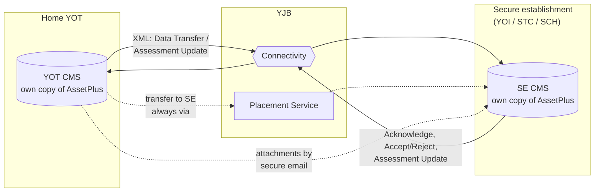
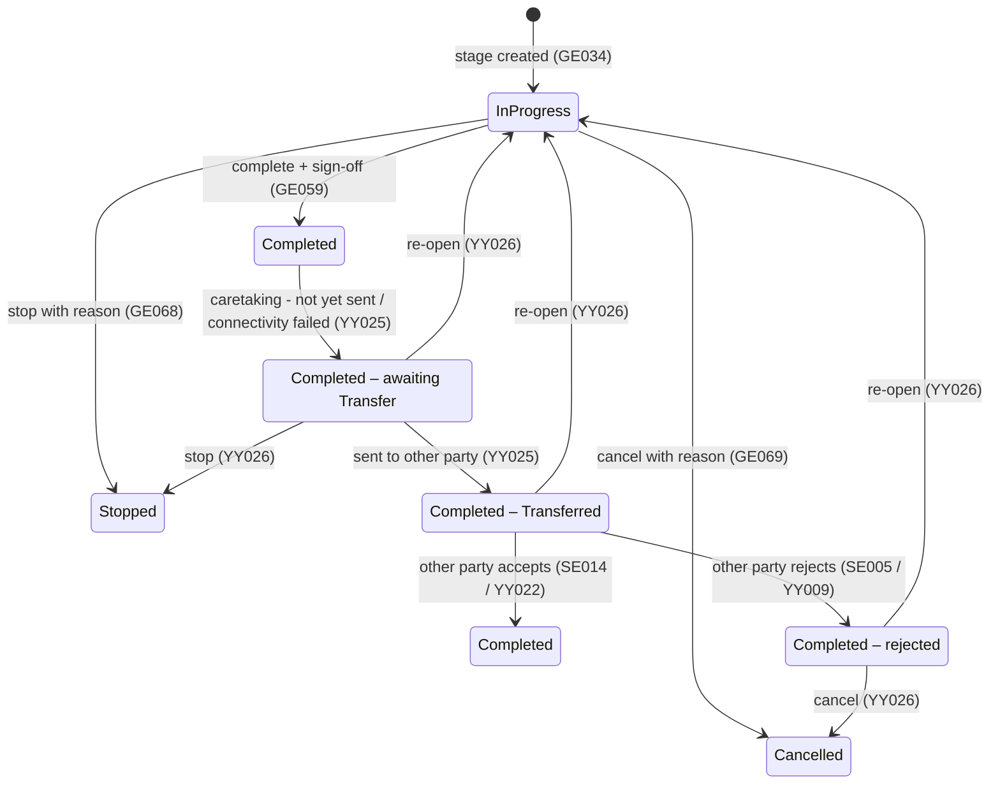
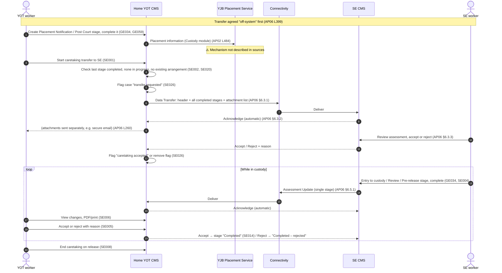

# How AssetPlus transfer works today

A high-level description of the current AssetPlus case-transfer process. It focuses on **Youth Offending Team (YOT) ↔ Secure Estate (SE)** transfers, including the YJB Placement Service. YOT ↔ YOT and YOT → Probation (Y2A) are covered briefly at the end.

**How to read this document**

- Every factual statement cites its source. The short references are explained in [documents-list.md](documents-list.md).
  - `[AP02 L874 SE001]` means AP 02, line 874, requirement SE001.
  - `[AP06 L336 §6.1]` means AP 06, line 336, section 6.1.
  - `[AssessmentTransfer L113]` means line 113 of `AssessmentTransfer-v12-0-0.xsd`. The other XSD files are cited the same way, by their name without the version suffix (e.g. `[SimpleTypes L166]`).
  - `[AP03 'Data Dictionary Master' col AT]` and `[PROTO 'Custody' row 218]` cite a sheet, column or row in the AP 03 and Prototype workbooks.
- Line numbers refer to the `.md` copies in `restricted-documents/`.
- Anything not stated in a source is marked as speculation:

> ⚠️ **Speculation:** like this.

- AP02, AP06 and AP03 date from 2014 [AP02 L9–11; AP06 L15–17; AP03 'Version History' last row]. They describe the requirements, the interface specification and the data dictionary.
- The XSD files are much newer: v12.0.0, dated 2026-11-02, after about 20 releases since AP06's v2.0 [AssessmentTransfer L5–88]. They are the best evidence we have of what the transfer messages contain today. Where they disagree with AP06, this document says so.
- No document here shows how CMS suppliers actually implemented any of this.

---

## 1. Summary

1. Each YOT and each secure establishment keeps its own copy of a young person's AssetPlus assessment in its own case management system (CMS) [AP06 L193, L274].
2. To move or share that assessment, the sending CMS builds an XML message to the AssetPlus Case Transfer Schema. It sends the message to the receiving CMS over **"Connectivity"**, a YJB platform that lets YJB systems talk to each other [AP06 L193, L260].
3. A transfer is either:
   - a **complete transfer**: ownership moves to another YOT, and sharing stops; or
   - a temporary **"caretaking" (home/host) arrangement**: both sides keep a copy and send each other completed stages as they go [AP02 L844 YY002; AP06 L334].
4. A transfer to a secure establishment is **always caretaking** and **always goes via the YJB Placement Service** [AP02 L874 SE001].
5. Each transfer or update is acknowledged automatically by the receiving system. A **person** at the receiving end then accepts or rejects it, choosing a reason from a standard list if they reject it [AP06 L400; AP02 L850 YY005, L886 SE005].
6. Attachments cannot travel over Connectivity. The message lists them, and the files themselves go separately, for example by secure email [AP06 L260–266]. In the v12 schema, the list is an attachment index attached to each stage [AssessmentTransfer L2679–2690].

> ⚠️ **Speculation:** The diagram shows the Placement Service as a step on the way to the SE. AP02 says the transfer "will always be via the YJB Placement Service" [AP02 L874 SE001], but neither document says how: whether the Placement Service relays the message, triggers it, or only decides the destination.

---

## 2. Actors and systems

| Actor / system | Role in transfer | Source |
| :-- | :-- | :-- |
| YOT (Youth Offending Team / Youth Justice Service) and its CMS | Owns the case. Starts transfers and chooses the destination. Can be the "Home" or "Host" YOT. | [AP06 L270–272 §4; AP02 L874 SE001] |
| Secure establishment (SE) and its CMS | Receives a caretaking copy when a young person goes into custody. Can complete stages and send updates back. | [AP02 L874 SE001, L882 SE004] |
| YJB Placement Service | All YOT→SE transfers go through it. Its custody-module information is used "to make a placement". The v12 schema carries the YOT's placement recommendation: an establishment *type* (SCH, STC or YOI), whether there is an establishment the child should not go to, and anything else "Placements" should know. | [AP02 L874 SE001, L484; AssessmentTransfer L1148–1186, L1155, L1165, L1170; SimpleTypes L823–829; PROTO 'Custody' rows 218–238] |
| Connectivity | YJB messaging platform between systems. Sends the automatic "acknowledge". Cannot carry unstructured data (files). | [AP06 L260, L400] |
| Y2A portal | Receives data feeds for transfers to probation (adjacent scope). | [AP02 L811 YA001] |
| YJMIS | Receives a data extract for management information (adjacent scope). | [AP02 L543 GE041] |

**Placements and SEs today:** placements and the secure estate currently use the same AssetPlus client system. In future we would like them to be able to use different client systems [User 2026-11-19].

> ⚠️ **Speculation:** If both use one client system, a "transfer to SE via the Placement Service" may today be a hand-over inside a single system rather than a message between two systems. We should confirm this with the team running that system.

---

## 3. What is being transferred: the assessment model

### 3.1 Structure

- Each young person has **one** "single, updateable assessment and plan" at any point in time [AP02 L508 GE001]. It is made up of:
  - the Core Record
  - four information-gathering quadrants
  - Explanations & Conclusions
  - Pathways & Planning [AP02 L960]
- **Modules** add information for specific events. The modules are:
  - Bail & Remand
  - PSR and Referral Order reports
  - Custody
  - Leaving Custody
  - Referrals
  - Restorative Justice
  - transfers (YOT to YOT, YOT to Probation) [AP02 L961]
- The Custody module "aims to provide placements with appropriate information to make a placement and secure establishments with key information when a young person arrives at custody" [AP02 L484].

### 3.2 Stages: the unit of change

- All edits happen inside an **assessment stage**, and **only one stage can be in progress at a time**. Between stages, the framework is read-only [AP02 L520 GE034].
- Which stage types a user can create depends on their organisation [AP02 L520 GE034]:
  - **YOT only:** Referral in (Prevention), Referral in (OOCD), Placement Notification, Bail Recommendation, Post Court, Pre-Sentence Report, Pre-Sentence Report (All Options), Sentenced (no report), Referral Order Report, Transfer to Probation, Transfer YOT to YOT, Case closure.
  - **YOT or SE:** Pre-release from custody, Review.
  - **SE only:** Entry to custody.
- The v12 schema has the same 15 stage types, but some names differ: "Entering into Custody", "Pre-Release from Custody", "Post Court Report" and "Pre Sentence Report" [SimpleTypes L166–184]. This document uses the GE034 names unless it is quoting the schema.
- Each stage also has a **case type**: Prevention, OOCD, Offending, or a combination of these [AssessmentTransfer L249; SimpleTypes L291–301]. This was added to the schema in v2.2.1 (2015) [AssessmentTransfer L75–76].
  - The data dictionary restricts which stage types are available for some case types. For example, a Prevention-only case can use only Referral in (Prevention), Review, Transfer YOT to YOT and Case Closure [AP03 'Data Items CONSOLIDATED' row 4, cols AH–AL].
  - So which stage a user can create depends on the case type as well as on the organisation.
- A stage has an **owner**, who is the person who started it (or the person a proxy started it for). A manager can step in during an emergency [AP02 L522 GE066, L523 GE071]. The schema records the stage owner, the proxy, and the stage's start and end dates [AssessmentTransfer L256–285].
- Statuses are 'In progress', 'Completed', 'Stopped' and 'Cancelled' [AP02 L524 GE058]:
  - **Completing** a stage needs managerial sign-off and all mandatory fields, and creates a snapshot [AP02 L525 GE059].
    - The schema has two countersignatures per stage, one for Explanations & Conclusions and one for Pathways & Planning. Each records a name, job title and date [AssessmentTransfer L334–335, L454–472].
  - **Stopping** needs a reason and also creates a snapshot. Changes made in a stopped stage pre-populate into the next stage [AP02 L526 GE068].
  - **Cancelling** can be done only by the stage owner who created the stage, and needs a reason. It hides the stage, keeps the audit trail, reverts the assessment to the previous stage, and notifies users assigned sub-sections [AP02 L527 GE069].
- Each new stage is pre-populated from the previous one [AP02 L532 GE005]. The data dictionary defines four pre-population rules, and gives each data item one of them [AP03 'Data Item pre population rules' rows 3–9; AP03 'Data Items CONSOLIDATED' col O]:
  1. always pre-populate (shared questions)
  2. pre-populate only if the hearing date (or, in a variant, the panel date) is the same
  3. pre-populate from the same module in a previous stage
  4. don't pre-populate
- The stage type triggers which modules apply [AP02 L521 GE067]. The table of trigger rules is **empty** in our copy [AP02 L919].
  - AP03 doesn't fill this gap. It has rules for each data item about which stages show it (336 items) and when it is mandatory [AP03 'Data Items CONSOLIDATED' cols N, Q], but no table mapping stages to modules.
  - The Prototype workbook says it doesn't depict assessment stages or the countersignature process [PROTO 'Please Read' rows 15–18].
- Users can retrieve earlier snapshots by date/time or stage type [AP02 L528 GE003]. There must be an audit trail of who changed what and when [AP02 L536 GE015].
  - In the transfer schema, audit works by **comparing a stage with the previous stage**; the stage owner is the person who made the change [AP06 L256].

### 3.3 Payload contents

- A transfer carries AssetPlus assessment data "and certain other data required to identify a case". It does **not** carry the whole CMS case [AP06 L209].
- AP06 lists the schema files as AssessmentTransfer, CoreRecord, HearingOffencesAndDisposals, PersonalFamilyAndSocialFactors, SelfAssessment, SupplierData, plus lookup lists [AP06 L286–297].
- The v12 set differs:
  - There's no SupplierData file.
  - There's a CaseTransfer sub-schema, added in v3.0.0 (2017), for the offence, hearing and disposal details used in case transfer [CaseTransfer L60–61, L66–258].
  - There's a YJMIS data-return schema, which is for management information [YJMIS-CMS-Schema L3].
- **Message structure (v12).**
  - The root element is `Case_Transfer` [AssessmentTransfer L113]. It holds:
    - a message ID (a GUID) and message version
    - the Assessment ID
    - the message type
    - an optional rejection reason, with free-text description
    - the originating and receiving organisations, each an OU code and name
    - zero or more assessment stages [AssessmentTransfer L339–367; SimpleTypes L1889–1894]
  - The schema expects the Assessment ID in the form `YYMMDDHHMM-OU-CYPID`, "where 'OU'=YJS 2-letter code" [AssessmentTransfer L348; SimpleTypes L145–149]. So the ID embeds a timestamp, the organisation and the CMS's own young-person ID.
- **Only completed stages are carried in full.** A stage's `Assessment_Status` can only be "Completed" [AssessmentTransfer L255; SimpleTypes L185–189]. This matches AP06's rule that incomplete stages are not sent [AP06 L237].
- **Stage index.** A stage can carry an index of the case's stages [AssessmentTransfer L336, L2667–2681]. Each entry gives:
  - the stage type and date
  - the stage's status: In progress, Completed, Stopped or Cancelled [SimpleTypes L1731–1738]
  - the YOT
  - the schema version the stage was recorded in
  - an attachment index
  - So a receiver learns that stopped, cancelled and in-progress stages exist, even though it doesn't receive their content.
  - The caretaking statuses ('Completed – awaiting Transfer' and so on) are **not** in the schema. They appear to be local to each CMS.
- Each stage's payload contains:
  - "primary information": Core Record, Information Gathering, Explanations, Pathways
  - the sections for the modules the stage type triggers. For example, *Entering into Custody* adds Custody, and *Pre-release from Custody* adds Leaving Custody [AP06 L361–378 Rule 4, L506–548].
- Offences, anti-social behaviour (ASB) and disposals get IDs that are unique within one XML document, so episodes and hearings can refer to them [AP06 L239, L662, L670].
  - Offence codes are sent with their title, so a receiver can still read the offence if it doesn't recognise the code [AP06 L251].
- Lookups come in two kinds [AP06 L241–243]:
  - **static** enumerations, fixed in the schema
  - **dynamic** values, such as offence codes, which are free text and validated by the CMS
- **Which data items transfer.** The data dictionary marks each item as transferred or not [AP03 'DD Field Guidance' row 34; AP03 'Data Dictionary Master' col AT]:
  - 1,037 items are transferred.
  - 27 are not. One example is the system-calculated "Young person currently in custody" flag [AP03 'Data Dictionary Master' row 1026].
  - 109 are marked "2b".
- **Supplier data** (fields prefixed `sd`) carries useful non-AssetPlus data between CMSs [AP06 L249]. Examples include contacts, events, hearings, key workers and alternative young person references [AP06 L882–892].
  - The 109 "2b" items in AP03 are these supplier-data items: "included to enable case transfer but are not part of AssetPlus" [AP03 'DD General Rules' row 13; AP03 'Data Dictionary Master' rows 1069–1177].
  - None of the v12 XSD files has a SupplierData structure or any `sd`-prefixed element. Only 14 of the 109 item names appear anywhere in them, and most of those are generic names such as `Notes`, `Location` and `Status`.
  > ⚠️ **Speculation:** a few supplier items, such as arrest date and address dates, now appear in the CaseTransfer and SimpleTypes structures [CaseTransfer L68; SimpleTypes L1861–1882]. Supplier data may have been partly absorbed into the main schema and partly dropped. No source says so.
- **Attachments.**
  - In AP06, attachments are listed in an `Unstructured_Data` structure and sent another way. The receiving YOT uses the list to check it got the expected files [AP06 L260–266].
  - In v12, `Unstructured_Data` has been removed (from the header in v3.0.1) [AssessmentTransfer L66; SimpleTypes L56]. Attachments are now listed per stage in the stage index, each as a section and a document name [AssessmentTransfer L2679–2690].
  - The schema still carries no file content.
- AP06 said schema v2-0 **"has not been tested with data from existing case management systems"** [AP06 L300–302].
  > ⚠️ **Speculation:** the regular releases since then (v3.0.0 in 2017 through v12.0.0 in 2026, mostly tied to financial years) [AssessmentTransfer L5–71] suggest the schema is in live use. No source confirms which CMSs use it.

---

## 4. The transfer flows

### 4.1 Message types and rules

- **Message types:** Data Transfer, Data Transfer Acknowledged, Data Transfer Rejected, Assessment Update, Assessment Update Acknowledged, Assessment Update Rejected [AP06 L325–332]. These cover both complete and caretaking transfers. "Caretaking" includes caretaking by the SE [AP06 L334].
  - In v12 the types are Data Transfer, Data Transfer **Accept**, Data Transfer **Reject**, Assessment Update, Assessment Update **Accept** and Assessment Update **Reject** [SimpleTypes L1119–1131].
  - So acceptance is now an explicit message, and there's no "Acknowledged" message type. This fits AP06's description of acknowledgement as an automatic receipt by Connectivity rather than a user action [AP06 L400].
- **Header:** every message has a header. It holds the message ID, version, type, response, rejection reason, originating YOT (OU code), receiving YOT, and a globally unique **Assessment ID** assigned by the CMS [AP06 L310–323, L406–422].
  - In v12 the originating and receiving parties are "organisations" rather than YOTs. The receiving organisation is optional [AssessmentTransfer L360–365].
  - The schema notes that the originating organisation "is needed in a 3 way sharing arrangment between Home YJS, Host YJS and SE" [AssessmentTransfer L362]. See §6 item 4.
  - The Message ID and Assessment ID stay the same for every message in one exchange [AP06 L280–282].
- **Payload rules:**
  - One case per message [AP06 L278, L357].
  - A **Data Transfer** carries **all completed stages** [AP06 L353].
  - An **Assessment Update** carries **one** stage [AP06 L355].
  - Incomplete stages are not sent [AP06 L237].
  - Stopped stages are not transferred [AP02 L874 SE001].
- **Who decides:**
  - A **YOT worker** starts the transfer and chooses the destination [AP06 L270–272].
  - The **sending CMS** checks that the stage is fit to transfer [AP06 L276].
  - The parties are expected to **agree transfers and the timing of updates "off-system"** [AP06 L399].
- **Acknowledge vs accept:** "Acknowledge" is the automatic receipt through Connectivity. Accepting or rejecting is done by a user [AP06 L400]. For updates, "systems will not be able to do this automatically so a YOT user will need to update the status of their case manually" [AP06 L556].

### 4.2 Starting caretaking with a secure establishment

**Preconditions.** The YOT can start the transfer only if:
- the last stage is completed and no stage is in progress [AP02 L876 SE002]
- no caretaking arrangement with the SE already exists [AP02 L877 SE020]

This applies whether the YOT is the Home YOT or the Host YOT [AP02 L874 SE001].

**What is sent.** The whole framework with all completed stages, but no stopped stages. The CMS must show that the young person is now in custody [AP02 L874 SE001].

**Flagging.** The case is flagged from the moment the transfer is made. The flag distinguishes **requested** from **accepted**, and is removed if the transfer is rejected or ended [AP02 L875 SE026].

**Response.** The receiving party acknowledges, then accepts or rejects [AP06 L391–393 §6.2]. Rejection reasons for an initial transfer are [AP06 L336–347 §6.1]:
- No agreement to transfer in place
- Wrong AssetPlus
- Wrong YOT
- Level of completeness
- Other

AP06 marks the first three reasons as "applicable to initial transfer only" [AP06 L347]. The v12 schema has a single list of all eight reasons (initial and update) and doesn't enforce that restriction [SimpleTypes L1342–1353].

> ⚠️ **Speculation:** AP02 doesn't say whether the **SE** can reject an initial caretaking transfer. YY005 covers YOT↔YOT [AP02 L850]. However, the AP06 flows list the SE as a possible "B" that accepts or rejects a sharing transfer [AP06 L391–393], so we assume it can.

**Updates.** Updates may be sent only once acceptance has been received and the arrangement exists [AP02 L878 SE019].

### 4.3 Sharing updates during caretaking

- Either the YOT or the SE can complete a new stage and send it to the other [AP02 L882 SE004]. The update is a single-stage **Assessment Update** message [AP06 L486–504 §6.5.1].
- **The YOT accepts or rejects an update from the SE.** It is reminded until it decides [AP02 L886 SE005].
  - Rejection reasons: Level of completeness, Errors of fact, Conflict in stages, Caretaking has ended, Other [AP02 L886 SE005; AP06 L336–347].
  - A rejected stage becomes 'Completed – rejected' [AP02 L886 SE005].
- On acceptance, the SE is notified automatically and the stage becomes 'Completed' [AP02 L887 SE014].
- The receiving YOT can see what changed in the stage, and can export the changes to PDF or print them [AP02 L888 SE006].
- The YOT decides which user roles may accept or reject SE transfers [AP02 L891 SE009].

> ⚠️ **Speculation / gap:**
> - SE005, SE014 and SE006 describe only the **YOT** receiving an update from the SE. AP02 has no matching requirement for the SE accepting or rejecting an update from the YOT. The AP06 update flow is written for either party [AP06 L394–396], so the process is probably symmetrical in practice.
> - YOT↔YOT says a rejected stage "is deleted from the rejecting YOT CMS" [AP02 L863 YY009]. SE005 doesn't say this.

### 4.4 Extra stage statuses during caretaking

Caretaking adds three statuses [AP02 L883 SE016, L857 YY025]:
- **'Completed – awaiting Transfer'**: completed but not sent. This is also the status if Connectivity fails.
- **'Completed – Transferred'**: sent.
- **'Completed – rejected'**: rejected by the other party.

A stage in any of these statuses can be stopped, cancelled or re-opened. Re-opening sets it back to 'in-progress' [AP02 L858 YY026, applied to SE by L883 SE016].

None of these three statuses is in the v12 schema. The stage index has only In progress, Completed, Stopped and Cancelled [SimpleTypes L1731–1738]. So each CMS tracks the caretaking statuses itself, and the other party never sees them.

> ⚠️ **Speculation:** The sources say "Completed" leads to the caretaking statuses, but they don't say exactly when. This diagram assumes a completed stage enters 'awaiting Transfer' automatically whenever a caretaking arrangement exists. The YY026 stop/cancel transitions apply to all three caretaking statuses; only some are drawn, to keep the diagram readable.

### 4.5 Ending caretaking

The **Home YOT** ends the arrangement when the young person leaves custody and returns to the YOT. After that, no more stage updates are shared [AP02 L890 SE008].

### 4.6 End-to-end sequence (YOT → SE)

---

## 5. Rules and checks summary (YOT ↔ SE)

| # | Rule | Source |
| :-- | :-- | :-- |
| R1 | Transfer to an SE is always caretaking, via the Placement Service | [AP02 L874 SE001] |
| R2 | Send the whole framework with all completed stages. Never send stopped or incomplete stages | [AP02 L874 SE001; AP06 L237] |
| R3 | Last stage must be completed, and no stage in progress | [AP02 L876 SE002] |
| R4 | Only one caretaking arrangement with the SE at a time | [AP02 L877 SE020] |
| R5 | Flag requested vs accepted. Remove the flag on reject or end | [AP02 L875 SE026] |
| R6 | No updates until acceptance has been received | [AP02 L878 SE019] |
| R7 | Either side may complete and send a stage | [AP02 L882 SE004] |
| R8 | A person accepts or rejects, using a standard reason list. Remind until they decide | [AP02 L886 SE005; AP06 L400] |
| R9 | Notify the sender on acceptance; the stage becomes 'Completed' | [AP02 L887 SE014] |
| R10 | Show changes in a received stage, with PDF/print | [AP02 L888 SE006] |
| R11 | Only the Home YOT can end caretaking (on leaving custody) | [AP02 L890 SE008] |
| R12 | Roles allowed to accept or reject are configured locally | [AP02 L891 SE009] |
| R13 | One case per message. Message ID and Assessment ID stay the same across an exchange | [AP06 L278–282] |
| R14 | Files travel outside the message. They are listed in `Unstructured_Data` (AP06), or in v12 in each stage's attachment index | [AP06 L260–266; AssessmentTransfer L2679–2690] |
| R15 | Show that the young person is in custody | [AP02 L874 SE001] |

**Considered but not built ("Wont")** [AP02 L879–897]. These are **not** current functionality:
- notifying the other side when a stage is created (SE012)
- warning when a stage is open elsewhere (SE022)
- cross-system locking (SE015)
- repeated reminders to send (SE021)
- recall (SE017)
- notifying the SE when the Host YOT changes (SE007)
- notifying on Connectivity failure (SE027)
- three-way Home/Host/SE routing (SE018, SE023–SE025)

---

## 6. Inconsistencies and gaps in the sources

1. **Empty stage trigger table.** "YOT Assessment stages and trigger rules" has a heading and no content [AP02 L919]. AP03 and the Prototype don't supply it either (§3.2).
2. **Stage names differ.**
   - GE034 lists "Entry to custody" and "Pre-release from custody" [AP02 L520].
   - PP049 lists "Entering Custody", "Pre-Release" and "Post-release" [AP02 L686].
   - AP06 uses "Entering into Custody" [AP06 L377].
   - The v12 schema uses "Entering into Custody" and "Pre-Release from Custody", and has no "Post-release" stage [SimpleTypes L166–184]. The schema list is the one a CMS must send, so it's the most reliable of the four.
3. **YY030 is used twice**, once marked "Wont" and once "Must", for different requirements [AP02 L854, L862].
4. **Three-way arrangements.** SE001 says updates go between the SE and the **Home** YOT only [AP02 L874]. SE018–SE025 describe Home→Host→SE routing, but they are all "Wont" [AP02 L894–897]. So when a Host YOT transfers to the SE, the routing is unclear. The v12 schema, though, says the originating organisation is needed for three-way sharing between Home YOT, Host YOT and SE [AssessmentTransfer L362]. This suggests three-way sharing does happen.
5. **Interim format.** SE010 requires output in the older "EYE" format until every SE has AssetPlus [AP02 L892]. Whether that still applies is unknown.
6. **Message type naming.**
   - The acknowledge header uses "Acknowledge Ownership Transfer Request" [AP06 L444], which isn't in AP06's message type list [AP06 L327–332].
   - The v12 list differs again: it uses Accept and Reject rather than Acknowledged and Rejected [SimpleTypes L1119–1131].
7. **No identity-matching rules.** No document defines how to match a young person between systems.
   - The only identifiers are the CMS-assigned Assessment ID [AP06 L323] and the "Current Young Person ID" printed on plans [AP02 L697].
   - Merging duplicate records is required, but no matching method is given [AP02 L870 YY014].
   - The v12 Assessment ID embeds the sending CMS's young-person ID [AssessmentTransfer L348], so every CMS has its own ID for the same child.
8. **Placement Service mechanism undescribed** (see §1). The schema carries a placement *recommendation* by establishment type [AssessmentTransfer L1165; SimpleTypes L823–829]. It has no field for the decision or for the establishment chosen. On arrival, the SE records its establishment as free text [AssessmentTransfer L230].
9. **AP06 is out of date against the schema.** AP06 describes schema v2-0 [AP06 L288, L300]; the XSDs are v12.0.0 [AssessmentTransfer L5]. Where they differ, this document notes it (§3.3, §4.1, §4.2).
10. **The data dictionary is older than the schema.**
    - AP03 is v5.0, last updated in its version history in September 2014 [AP03 'Version History' last row].
    - The schema's documentation fields still cite data dictionary field IDs [e.g. AssessmentTransfer L246]. Its change log refers to "accompanying documentation" for each release [AssessmentTransfer L5–6], which we don't have.
    - The Prototype says it reflects requirements "up to schema v11" [PROTO 'Please Read' row 5].
    - So no source we hold describes the data items of v12 in full.
11. **Supplier data.** AP03 defines 109 supplier-data items for transfer [AP03 'Data Dictionary Master' rows 1069–1177], but v12 has no SupplierData schema (§3.3).
12. **Organisation codes.**
    - AP03 lists 258 YOTs with 7-character OU codes, e.g. `F00BK00` [AP03 'YOT Full List' rows 2–259].
    - The Assessment ID expects a "YJS 2-letter code" [AssessmentTransfer L348].
    - No source lists OU codes for secure establishments or the Placement Service.
13. **GE069 wording.** The cancel requirement asks for "a reason why the stage has been stopped" and says users are notified "if a stage has been stopped" [AP02 L527 GE069]. This looks like text copied from GE068 (stop). We read it as a reason for cancelling.

---

## 7. Adjacent flows (brief)

- **YOT ↔ YOT complete transfer.**
  - Ownership moves and sharing stops [AP02 L844 YY002].
  - Not allowed for a Looked After Child [AP02 L849 YY017]. It "should" also be blocked while breach proceedings are pending [AP02 L848 YY004].
  - A rejected framework is deleted at the rejecting YOT [AP02 L850 YY005].
  - A Host YOT cannot transfer the case on to another YOT [AP02 L868 YY013].
  - Two copies can be merged by ordering stages by completion date [AP02 L870 YY014].
- **YOT ↔ YOT caretaking** follows the same pattern as YOT ↔ SE: YY008/YY009/YY010/YY011 [AP02 L856–866]. Ending caretaking can instead turn into a complete transfer to the Host [AP02 L866 YY011].
- **YOT → Probation (Y2A).**
  - Triggered by a "Transfer to Probation" stage [AP02 L813 YA003].
  - Data goes to the Y2A portal as a feed "using the new AssetPlus XML schema" [AP02 L811 YA001].
  - Transfers from a YOI to an adult prison use printed documents, marked "TBC" [AP02 L812 YA002].
  - The sources describe no acknowledgement or rejection for Y2A.
- **YJMIS.** The YJMIS data-return schema embeds whole AssetPlus stages [YJMIS-CMS-Schema L1563]. So management information receives assessment content as well as summary data.
