# Data-sync user flow: sequence diagram

The user flow from the slide "The recommendation we're taking forward" [DSYNC p1], drawn as a sequence diagram with every API call shown. The slide leaves some calls out for brevity [User 2026-11-26]. This diagram adds them, using the routes in `../swagger.yaml` and `proposed-transfer-api.yaml`.

Written 2026-11-26. Revised 2026-11-27 [User 2026-11-27].

Also exported as `data-sync-sequence.png` and `data-sync-sequence.svg`, made with mermaid-cli 11.4.2. The text is set in Inter, falling back to Helvetica and Arial [User 2026-11-27]. Inter wasn't installed where the exports were made, so they use Helvetica, and the SVG uses whichever of these fonts the viewer has.

## Key

- **Verticals:** one for each organisation, in the slide's colours: the YJS (teal), the YJB Placement Service (yellow), the secure establishment (orange) and the new YJP, which is the slide's "System processes" lane (lilac) [DSYNC p1; User 2026-11-26]. Each has a line and a label box in the slide's colour, with a pale tint behind it [User 2026-11-27].
  - The lines, label boxes, tint outlines and the thicker Placement arrow use custom CSS (`themeCSS`). It works in mermaid-cli 11.4.2.
- **Shaded bands:** new behaviour, shown on the slide in red text [DSYNC p1; User 2026-11-26].
- **Stages:** the names stand for `stageid`s [User 2026-11-27]:
  - **Initial YJS Stage** (`InitialYJS`): the YJS's first Stage
  - **SE update** (`SEUpdate`): the SE's Stage
  - **YJS update** (`YJSUpdate`): the YJS's second Stage, open while the SE works on its update
  - **YJS Review** (`YJSReview`): the YJS's Review Stage
- **`…/stages/X`** is short for `/children/{ypid}/stages/X`.
- **The thick double-headed arrow** is the Placement user working in the new YJP's web interface, not an API call. Its detail is omitted, as on the slide.
- **Headers:** every `PATCH` and `PUT` sends `If-Match` with the Stage's current `ETag` and an `Idempotency-Key`, and every response gives the new `ETag` [swagger.yaml L402–443, L453–527]. They're left out of the arrows to keep them short.

## Diagram

```mermaid
%%{init: {"fontFamily": "Inter, Helvetica, Arial, sans-serif", "sequence": {"actorFontFamily": "Inter, Helvetica, Arial, sans-serif", "messageFontFamily": "Inter, Helvetica, Arial, sans-serif", "noteFontFamily": "Inter, Helvetica, Arial, sans-serif"}, "themeCSS": "text, tspan { font-family: Inter, Helvetica, Arial, sans-serif !important; } #actor0 { stroke: #84E8DF !important; stroke-width: 6px !important; } #actor1 { stroke: #FFE86D !important; stroke-width: 6px !important; } #actor2 { stroke: #FFB575 !important; stroke-width: 6px !important; } #actor3 { stroke: #DEDAFF !important; stroke-width: 6px !important; } rect.actor[name=YJS] { stroke: #84E8DF !important; stroke-width: 4px !important; fill: #84E8DF !important; } rect.actor[name=PS] { stroke: #FFE86D !important; stroke-width: 4px !important; fill: #FFE86D !important; } rect.actor[name=SE] { stroke: #FFB575 !important; stroke-width: 4px !important; fill: #FFB575 !important; } rect.actor[name=P] { stroke: #DEDAFF !important; stroke-width: 4px !important; fill: #DEDAFF !important; } line[data-from=PS] { stroke-width: 4px !important; } rect.rect[fill^=rgb\\(218] { stroke: rgb(218,248,245) !important; } rect.rect[fill^=rgb\\(255\\,248] { stroke: rgb(255,248,211) !important; } rect.rect[fill^=rgb\\(255\\,233] { stroke: rgb(255,233,214) !important; } rect.rect[fill^=rgb\\(245] { stroke: rgb(245,244,255) !important; }"}}%%
sequenceDiagram
    autonumber

    box rgb(218,248,245)
        participant YJS as YJS user<br/>(via CMS)
    end
    box rgb(255,248,211)
        participant PS as Placement user<br/>(via new YJP web)
    end
    box rgb(255,233,214)
        participant SE as SE user<br/>(poss via CMS)
    end
    box rgb(245,244,255)
        participant P as New YJP
    end

    %% Row 1 of the slide: the YJS creates the record and its first Stage
    Note over YJS: Enters data into CMS
    YJS->>P: GET /children<br/>(name, date of birth and postcode in X-Parameters)
    P-->>YJS: 200 [ ] (no match)
    YJS->>P: POST /children (MinimalChild)
    Note over P: Creates AssetPlus record in central store,<br/>including de-doop process
    P-->>YJS: 200 ypid
    YJS->>P: POST /children/{ypid}/stages<br/>(child, stage_type, case_type, schema_version)
    P-->>YJS: 201 stageid InitialYJS, ETag

    rect rgba(141,16,14,0.1)
        loop As data is saved or entered
            YJS->>P: PATCH …/stages/InitialYJS (partial Stage)
            P-->>YJS: 204 No Content
        end
    end

    Note over YJS: Completes Initial YJS Stage,<br/>two-person sign-off
    YJS->>P: PUT …/stages/InitialYJS<br/>(countersignatures, based_on: null)
    P-->>YJS: 200 status: completed
    Note over P: Initial YJS Stage appended to AssetPlus

    %% Placement, kept as simple as on the slide
    PS<<->>P: Updates data in new YJP (based on imported AssetPlus),<br/>then makes Placement decision (recorded in new YJP#59; detail omitted)

    %% The SE and the YJS both start Stages
    SE->>P: GET /children/{ypid}
    P-->>SE: 200 full AssetPlus data packet
    SE->>P: POST …/stages
    P-->>SE: 201 stageid SEUpdate, ETag

    rect rgba(141,16,14,0.1)
        loop As data is saved or entered
            SE->>P: PATCH …/stages/SEUpdate (based_on: InitialYJS)
            P-->>SE: 204 No Content (no other partial Stage)
        end
    end

    YJS->>P: POST …/stages
    P-->>YJS: 201 stageid YJSUpdate, ETag

    rect rgba(141,16,14,0.1)
        Note over YJS,P: Both organisations make changes to their draft Stages
        YJS->>P: PATCH …/stages/YJSUpdate (based_on: InitialYJS)
        P-->>YJS: 200 Notification:<br/>the SE has a partial Stage open
        Note over YJS: YJS user is notified that a partial Stage<br/>has been created by the SE user

        %% Row 2 of the slide: both edit, then the SE completes
        SE->>P: PATCH …/stages/SEUpdate
        P-->>SE: 200 Notification:<br/>the YJS has a partial Stage open
        Note over SE: SE user is notified that a partial Stage<br/>has been created by the YJS user
        YJS->>P: PATCH …/stages/YJSUpdate
        P-->>YJS: 200 Notification:<br/>the SE has saved changes since you were last told
        Note over YJS: YJS user is notified that edits<br/>have been made by the SE user
        SE->>P: PATCH …/stages/SEUpdate (last save before sign-off)
        P-->>SE: 200 Notification:<br/>the YJS has saved changes since you were last told
        Note over SE: SE user is notified that edits<br/>have been made by the YJS user
    end

    Note over SE: Completes SE update,<br/>two-person sign-off
    SE->>P: PUT …/stages/SEUpdate<br/>(countersignatures, based_on: InitialYJS)
    P-->>SE: 200 status: completed_shared
    Note over P: SE update appended to AssetPlus.<br/>Pending review created for the YJS

    %% The YJS must deal with the SE update before it can complete its own

    rect rgba(141,16,14,0.1)
        Note over YJS: Goes to finish YJS update.<br/>Required to accept the incoming Stage first.
        YJS->>P: PUT …/stages/YJSUpdate (based_on: InitialYJS)
        P-->>YJS: 422 rule: review of SE update pending,<br/>and YJS update not yet rebased onto it
    end

    YJS->>P: GET …/stages/SEUpdate, then GET …/stages/SEUpdate/changes
    P-->>YJS: 200 SE update, and what changed

    %% Accepting the SE update: the Review Stage is part of the accept
    rect rgba(141,16,14,0.1)
        YJS->>P: POST …/stages (stage_type: Review)
        P-->>YJS: 201 stageid YJSReview, ETag
        Note over P: Holds both open Stages, YJS update and YJS Review, in the central store.<br/>Allowed as an exception to one partial Stage per organisation
        YJS->>P: PATCH …/stages/YJSReview (based_on: SEUpdate)
        P-->>YJS: 204 No Content
        YJS->>P: POST …/stages/SEUpdate/reviews (decision: accept)
        P-->>YJS: 201 Review
        Note over P: SE update becomes completed
    end
    Note over YJS: Completes YJS Review,<br/>two-person sign-off
    YJS->>P: PUT …/stages/YJSReview<br/>(countersignatures, based_on: SEUpdate)
    P-->>YJS: 200 status: completed_shared
    Note over P: YJS Review appended to AssetPlus.<br/>Pending review created for the SE

    %% The YJS rebases its update and completes it
    rect rgba(141,16,14,0.1)
        YJS->>P: GET /children/{ypid}/stages
        P-->>YJS: 200 [InitialYJS, SEUpdate, YJSReview]
        Note over YJS: Rebases open YJS update onto SE update and YJS Review
        YJS->>P: PATCH …/stages/YJSUpdate (based_on: YJSReview)
        P-->>YJS: 204 No Content
    end
    Note over YJS: Completes YJS update,<br/>two-person sign-off
    YJS->>P: PUT …/stages/YJSUpdate<br/>(countersignatures, based_on: YJSReview)
    P-->>YJS: 200 status: completed_shared
    Note over P: YJS update appended to AssetPlus.<br/>Pending review created for the SE
```

## How this differs from the slide

1. **Calls the slide leaves out** are shown: `POST /children` to create the record, the SE's `GET /children/{ypid}`, viewing the Stage and its changes before deciding, and `POST …/reviews` for the decision [User 2026-11-26; swagger.yaml L111; proposed-transfer-api.yaml L375–463].
2. **The SE hears about the YJS's edits before completing, not after.** The slide shows the notice after the SE completes its Stage. The `PUT` response carries no `Notification` [User 2026-11-24], so the notice comes back on the SE's last `PATCH` before sign-off.
3. **The refused `PUT` (step 30)** shows the platform's blocking rule in action [User 2026-11-26; swagger.yaml L453–527]. ⚠️ Speculation: in practice a CMS would probably check `GET /reviews` first and not send that `PUT`.
4. ~~**The SE is told its Stage was accepted** (`review.accepted`), which AP02 requires [AP02 L887 SE014]. The slide doesn't show this.~~ **Removed 2026-11-27:** not important for this diagram [User 2026-11-27]. AP02 still requires the notice [AP02 L887 SE014], and the design still sends it.
5. **What happens next isn't shown.** The YJS Review and the YJS update are now pending the SE's review, and the SE deals with them the same way before it can complete its next Stage. The rule applies in both directions [User 2026-11-26].
6. **How each party hears about the other's completed Stage is omitted for now** [User 2026-11-27]: the optional webhook telling the SE about the Placement, and the YJS's optional `stage.shared` webhook and `GET /reviews` inbox check (option C3) [User 2026-11-23 Q38]. The slide's note that the YJS user is notified of the new Stage from the SE is left out too.

## Decisions this diagram relies on

- **Notifications** on `PATCH` are sent when the other party's partial Stage is new to the caller, or has been saved since the caller was last told about it [User 2026-11-26]. Made through `api-patch-006-notifications-review-stage.patch` [swagger.yaml L402–404, L428].
- **A Review Stage may be open alongside another partial Stage** of the same organisation, as an exception to one partial Stage per organisation [User 2026-11-26; User 2026-11-23 Q28]. Made through `api-patch-006-notifications-review-stage.patch` [swagger.yaml L284]. ⚠️ Whether the Stage type is always "Review" is still to be confirmed (Q27).
- **The Review Stage is part of accepting.** It's opened before the accept decision is recorded, in the same step of the flow [User 2026-11-27].
- **`POST …/stages` returns `201 Created` with the new Stage's first `ETag`**, so the first `PATCH` can send `If-Match` without fetching the Stage first [User 2026-11-27]. Made through `api-patch-007-create-stage-etag.patch` [swagger.yaml L318–337].
- **Placement** is kept as simple as on the slide: the transfer calls are left out [User 2026-11-26].
